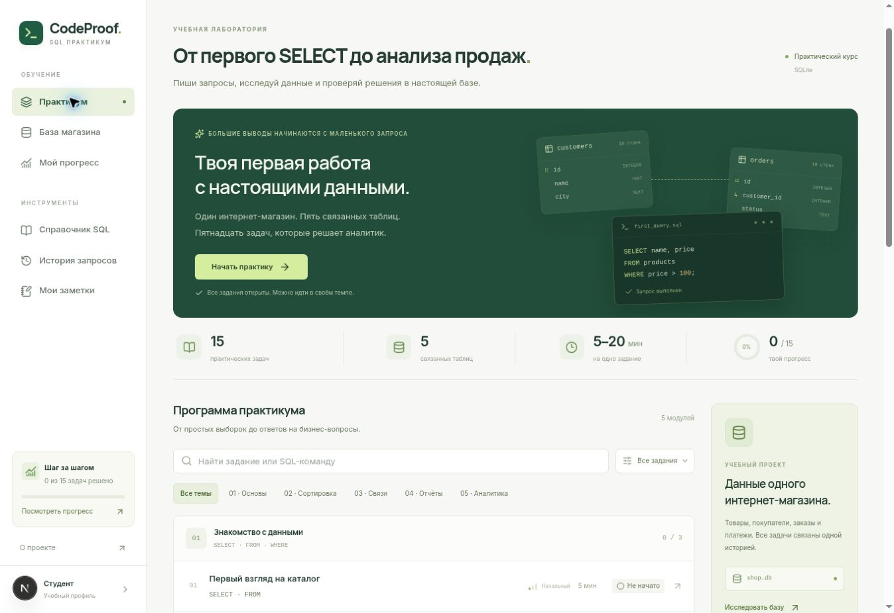

# CodeProof SQL

Практикум по SQL на данных интернет-магазина: 15 задач, 5 связанных таблиц и настоящий SQLite в браузере. Проект переработан из общего помощника по программированию в самостоятельную среду практики анализа данных.



## Запуск

Нужен Node.js 20.9+.

```bash
npm ci
npm run dev
```

Откройте адрес из терминала. Для своего порта: `npm run dev -- --port 3001`.

```bash
npm test
npm run typecheck
npm run lint
npm run build
npm start
```

`npm run build` создаёт статический сайт в `out/`. `npm start` запускает просмотр готовой сборки. Содержимое `out/` можно разместить на статическом хостинге в корне домена. Бэкенд, API-ключи и внешние сервисы не нужны. Шрифты и SQLite поставляются вместе с приложением.

## Что работает

- Каталог задач с поиском, фильтрами по модулю и статусу.
- Редактор SQL с подсветкой, автодополнением схемы и горячими клавишами: Ctrl/Cmd+Enter — запуск, Ctrl/Cmd+Shift+Enter — проверка. Чтобы выйти из редактора клавишей Tab, сначала нажмите Escape.
- Выполнение SELECT и WITH в SQLite через sql.js / WebAssembly, в отдельном Web Worker.
- Проверка результатов на учебной базе и двух изменённых наборах данных: значения, число строк, дубликаты, NULL, порядок столбцов и, когда требуется, строк. Допускаются разные способы решения и псевдонимы столбцов.
- Три постепенные подсказки, теория, отдельный разбор решения.
- Обозреватель всех таблиц, поиск по строкам, описание полей и связей.
- Черновики каждого задания, история последних 100 запусков, заметки, прогресс по модулям.
- Продолжение с последней открытой задачи, переход к следующей нерешённой и отдельное состояние завершённого курса. Открытая задача и изменённый черновик учитываются фильтром «В процессе».
- Повторное прохождение отдельной задачи: новый черновик и сброс подсказок/результата, с сохранением прошлых запросов в истории и работы над другими заданиями. Счётчики этой задачи начинаются заново.
- Подтверждение перед заменой черновика из истории или готовым решением, скачивание текущего SQL, ручная остановка долгого запроса без потери попытки.
- Различие между самостоятельным решением и решением с помощью; обычный запуск не засчитывает задачу.
- Экспорт результатов в CSV, резервная копия прогресса в JSON, импорт с проверкой формата и подтверждением замены.
- Отмена последнего импорта или общего сброса, пока открыта страница профиля. Скачанную копию можно восстановить после перезагрузки; импорт принимает файлы до 16 МБ.
- Адаптивный интерфейс, клавиатурная навигация, видимый фокус, диалоги с Escape.
- Мобильное меню закрывается после перехода и по Escape; фокус остаётся внутри открытого меню.

Все задания доступны сразу, в том числе гостю. Учебные аккаунты позволяют вести отдельный прогресс в одном браузере.

## Роли для демонстрации

1. В меню **Войти → Регистрация студента** укажите имя, логин и учебный пароль. После регистрации войдите с этими данными.
2. Решите задачу под аккаунтом студента. Его черновики, история, заметки и прогресс хранятся отдельно от гостевого профиля и других аккаунтов.
3. Выйдите через раздел **Аккаунт**. Нажмите **Настроить демо администратора**, придумайте отдельный логин и пароль, затем войдите. Создание первого администратора доступно один раз в браузере.
4. В панели администратора найдите студента по имени или логину, посмотрите число решённых задач и самостоятельных решений. Приостановите его вход, проверьте отказ при входе студентом и восстановите доступ с аккаунта администратора. Прогресс студента сохранится.

Это клиентская демонстрация ролей. Реестр аккаунтов хранится в localStorage, вход действует в текущей вкладке и сохраняется при её перезагрузке. Пароли хранятся в виде хеша с индивидуальной солью. Проверку прав выполняет браузер, поэтому пользователь с доступом к его хранилищу может изменить данные. Для реальных общих аккаунтов и защищённого администрирования нужна серверная авторизация.

## Учебная база

`products` → `order_items` ← `orders` → `customers`; `payments` связана с `orders`.

Данные синтетические. Стоимость заказов считается по исторической цене `order_items.unit_price`, выручка — только по завершённым заказам. Наборы проверки содержат изменения цен и статусов, граничное значение 100, одинаковые имена, новые идентификаторы, частичные и неудачные платежи.

## Ограничения

Гостевой прогресс хранится в localStorage этого браузера (`codeproof.sql.v1`), для каждого аккаунта используется отдельное сохранение. Для переноса прогресса между устройствами или из гостевого профиля в аккаунт используйте экспорт и импорт. JSON-файл прогресса содержит учебные данные, а аккаунты создаются отдельно. Старые сохранения прежней версии приложения не удаляются и в SQL-прогресс не преобразуются.

Это тренажёр для самостоятельной практики, а не защищённая экзаменационная система. Эталонные решения и проверочные наборы поставляются на клиент. Проверка конечного числа наборов не доказывает корректность запроса для всех возможных данных.

Разрешён один запрос SELECT/WITH за запуск. База доступна только для чтения и создаётся заново для каждого запуска. Вывод ограничен 1 000 строками; запросы дольше 3,5 секунд останавливаются завершением worker, затем движок можно запустить снова. Максимальная длина запроса — 20 000 символов.

## Устройство проекта

- `app/lib/sql/course.ts` — задания, теория, подсказки и решения.
- `app/lib/sql/schema.ts` — схема и три набора данных.
- `app/lib/sql/engine.ts` — SQLite-запуск и сравнение результатов.
- `app/lib/sql/sql-worker.ts`, `client.ts` — worker, таймауты и восстановление.
- `app/lib/sql/progress.ts`, `store.ts` — проверка импортов и сохранения.
- `app/components/sql/` — каталог, редактор, рабочая область и общая оболочка.
- `tests/` — проверка SQL, бизнес-расчётов, ошибочных решений, сохранений и жизненного цикла worker.

`predev` и `prebuild` собирают worker и копируют SQLite WASM и лицензию из установленного `sql.js` в `public/sql/`. Сгенерированные файлы не хранятся в Git. Скрипт запуска преобразует параметры `--host` и `--strictPort`, используемые средой предпросмотра, в параметры Next.js.

## Команда

- Куанышбек Ерасыл — Frontend, [Smylorx](https://github.com/Smylorx).
- Маметжан Абзал — разработка, [AbaD3v](https://github.com/AbaD3v).
- Кәрғұл Ерсұлтан — UI/UX, [ersultankargul07-alt](https://github.com/ersultankargul07-alt).
