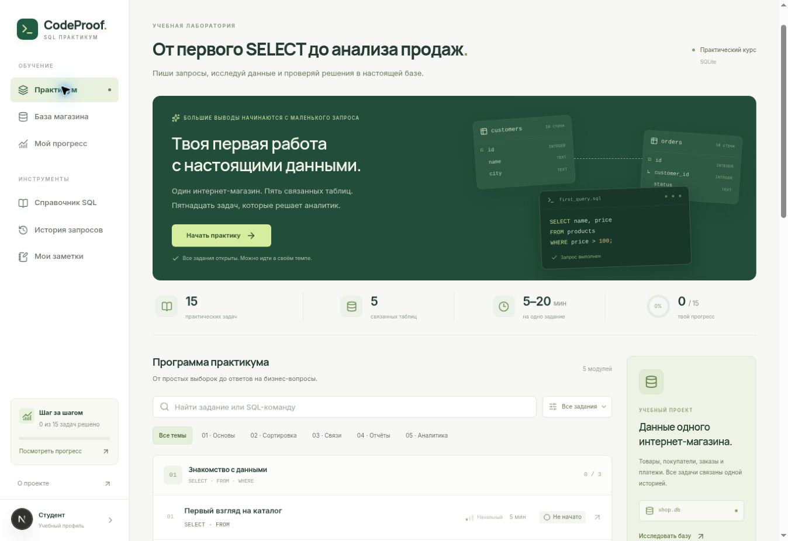

# CodeProof SQL

Практикум по SQL на данных интернет-магазина: 15 задач, 5 связанных таблиц и настоящий SQLite в браузере. Студент изучает схему магазина, пишет запросы и проверяет их на нескольких наборах данных. Все задания доступны без регистрации.

Сайт собирается в статические страницы. Учебные запросы выполняются локально через SQLite. Supabase Auth и PostgreSQL обеспечивают общий вход, прогресс и настройки сайта.



## Быстрый старт

Нужны Node.js 20.9 или новее, npm и современный браузер с поддержкой WebAssembly и Web Workers. Открывайте приложение через localhost или HTTPS.

```bash
git clone https://github.com/AbaD3v/AbaD3v-AIU.git
cd AbaD3v-AIU
npm ci
npm run dev
```

Откройте адрес из терминала. Для своего порта: `npm run dev -- --port 3001`. Без переменных Supabase приложение запускается в локальном деморежиме.

### Первая задача

1. Откройте каталог и выберите первое задание.
2. Изучите условие и столбцы таблицы `products`.
3. Введите запрос:

   ```sql
   SELECT name, price
   FROM products;
   ```

4. Нажмите **Запустить**, чтобы увидеть данные, затем **Проверить**, чтобы засчитать решение.
5. Перейдите к следующей нерешённой задаче. Гостевой прогресс сохраняется в браузере. После входа в облачный аккаунт прогресс синхронизируется между устройствами.

### Команды разработки

| Команда | Назначение |
| --- | --- |
| `npm run dev` | Подготовить SQL-ресурсы и запустить Next.js с Webpack |
| `npm test` | Запустить тесты SQL, прогресса, аккаунтов и worker-клиента |
| `npm run typecheck` | Проверить типы TypeScript без сборки |
| `npm run lint` | Проверить код ESLint |
| `npm run build` | Подготовить SQL-ресурсы и собрать статический сайт в `out/` |
| `npm start` | Запустить локальный просмотр готового `out/` через `serve` |

### Публикация

```bash
npm run build
npm start
```

Содержимое `out/` можно разместить на статическом хостинге в корне домена. Конфигурация использует `output: "export"` и `trailingSlash: true`; страницы заданий генерируются при сборке. Постоянно работающий сервер Next.js не требуется.

Шрифты, SQL worker и SQLite WASM поставляются вместе с приложением. Пути к SQL-ресурсам начинаются с `/sql/`, поэтому публикация в подпапке требует отдельной настройки путей. Не открывайте сборку напрямую через `file://`: используйте HTTP-сервер.

## Стек

| Часть приложения | Технологии |
| --- | --- |
| Интерфейс и маршрутизация | Next.js 16.4.2, React 19.3, TypeScript |
| Оформление | Tailwind CSS 4, глобальные стили, Lucide React |
| Редактор запросов | CodeMirror 6, SQL-подсветка и автодополнение |
| Выполнение SQL | SQLite через sql.js и WebAssembly, отдельный Web Worker |
| Аккаунты и данные | Supabase Auth, PostgreSQL с RLS, localStorage для гостей и деморежима |
| Сборка SQL-ресурсов | esbuild и `scripts/prepare-sql.mjs` |
| Проверки | Node.js test runner с tsx, TypeScript, ESLint |

## Программа курса

15 заданий объединены в пять модулей. У каждого задания есть условие, стартовый запрос, теория, три подсказки и разбор решения.

| Модуль | Темы |
| --- | --- |
| Знакомство с данными | SELECT, FROM, WHERE |
| Порядок и первые итоги | ORDER BY, DISTINCT, GROUP BY |
| Связи между таблицами | JOIN, LEFT JOIN, SUM |
| От данных к отчётам | GROUP BY, HAVING, даты |
| Работа аналитика | Подзапросы, CTE, проверка данных |

Задания и учебные материалы находятся в [app/lib/sql/course.ts](app/lib/sql/course.ts).

## Страницы приложения

| Путь | Что находится на странице |
| --- | --- |
| `/` | Каталог заданий, поиск, фильтры и продолжение практики |
| `/practice/[id]/` | Условие задачи, SQL-редактор, результаты и проверка |
| `/database/` | Учебные таблицы, поля, связи и данные |
| `/reference/` | Справочник SQL с поиском и примерами |
| `/history/` | История запросов |
| `/notes/` | Учебные заметки |
| `/profile/` | Прогресс, экспорт, импорт и сброс сохранений |
| `/account/` | Регистрация, вход и управление текущей сессией |
| `/admin/` | Панель администратора для управления студентами, названиями и тестами |
| `/about/` | Описание проекта и команда |

`/examples/` показывает тот же справочник, что и `/reference/`, а `/checklist/` использует страницу прогресса.

## Что работает

- Каталог задач с поиском, фильтрами по модулю и статусу.
- Редактор SQL с подсветкой, автодополнением схемы и горячими клавишами: Ctrl/Cmd+Enter - запуск, Ctrl/Cmd+Shift+Enter - проверка. Чтобы выйти из редактора клавишей Tab, сначала нажмите Escape.
- Выполнение SELECT и WITH в SQLite через sql.js / WebAssembly, в отдельном Web Worker.
- Проверка результатов на учебной базе и двух изменённых наборах данных: значения, число строк, дубликаты, NULL, порядок столбцов и, когда требуется, строк. Допускаются разные способы решения и псевдонимы столбцов.
- Три постепенные подсказки, теория, отдельный разбор решения.
- Обозреватель всех таблиц, поиск по строкам, описание полей и связей.
- Черновики каждого задания, история последних 100 запусков, заметки, прогресс по модулям.
- Продолжение с последней открытой задачи, переход к следующей нерешённой и отдельное состояние завершённого курса. Открытая задача и изменённый черновик учитываются фильтром «В процессе».
- Повторное прохождение отдельной задачи: новый черновик и сброс подсказок/результата, с сохранением прошлых запросов в истории и работы над другими заданиями. Счётчики этой задачи начинаются заново.
- Подтверждение перед заменой черновика из истории или готовым решением, скачивание текущего SQL, ручная остановка долгого запроса без потери попытки.
- Различие между самостоятельным решением и решением с помощью; обычный запуск не засчитывает задачу.
- Экспорт результатов в CSV, резервная копия прогресса в JSON, импорт с проверкой формата и подтверждением замены.
- Отмена последнего импорта или общего сброса, пока открыта страница профиля. Скачанную копию можно восстановить после перезагрузки; импорт принимает файлы до 16 МБ.
- Адаптивный интерфейс, клавиатурная навигация, видимый фокус, диалоги с Escape.
- Мобильное меню закрывается после перехода и по Escape; фокус остаётся внутри открытого меню.

Все задания доступны сразу, в том числе гостю. Облачные аккаунты позволяют продолжить работу с другого устройства.

## Подключение Supabase

1. Создайте отдельный проект Supabase для CodeProof SQL и выполните в **SQL Editor** миграцию [202611250001_codeproof.sql](supabase/migrations/202611250001_codeproof.sql).
2. В **Authentication → URL Configuration** укажите адрес сайта в **Site URL**. Добавьте точные адреса страницы аккаунта, например `https://ваш-домен/account/` и `http://localhost:3000/account/`, в список разрешённых перенаправлений.
3. Включите регистрацию по электронной почте и её подтверждение. Для отправки писем студентам вне команды проекта настройте [свой SMTP](https://supabase.com/docs/guides/auth/auth-smtp).
4. Скопируйте `.env.example` в `.env.local`. Заполните `NEXT_PUBLIC_SUPABASE_URL` адресом проекта и `NEXT_PUBLIC_SUPABASE_PUBLISHABLE_KEY` ключом `sb_publishable_…`. При публикации задайте эти переменные в окружении сборки и заново выполните `npm run build`. В статическую сборку попадает публичный ключ. Доступ к строкам проверяют политики PostgreSQL.

### Вход через Google

1. В [Google Auth Platform](https://console.cloud.google.com/auth/clients) создайте OAuth-клиент типа **Web application**. В **Authorized redirect URIs** добавьте `https://<project-ref>.supabase.co/auth/v1/callback`. Для проекта CodeProof SQL `project-ref` — `exnssqjmigddfqasuznb`.
2. В **Authentication → Sign In / Providers → Google** включите провайдера и сохраните Client ID и Client Secret. Client Secret вводится в Supabase Dashboard.
3. В списке разрешённых перенаправлений Supabase оставьте точный адрес страницы `/account/` для каждого адреса сайта, где будет работать вход. Кнопка появится, когда Supabase сообщит, что Google включён.

Если приложение Google пока в режиме тестирования, добавьте тестовые аккаунты в список **Audience → Test users**. [Руководство по настройке](https://supabase.com/docs/guides/auth/social-sign-in/auth-google).

Зарегистрируйте преподавателя через страницу **Аккаунт** и подтвердите его почту. В SQL Editor назначьте роль, подставив этот подтверждённый адрес:

```sql
update public.codeproof_profiles p
set role = 'admin'
from auth.users u
where p.id = u.id
  and u.email = 'teacher@example.com'
  and u.email_confirmed_at is not null;
```

Войдите в аккаунт преподавателя. Администратор видит студентов и статус задач, управляет доступом и публикует общие названия и тесты. Заметки, SQL-черновики, история и результаты тестов доступны владельцу аккаунта. Статистика практики и тестов формируется в браузере и предназначена для учебной обратной связи.

При переходе с деморежима пользователи заново регистрируются по почте. Экспортируйте прогресс из локального профиля и импортируйте его после входа в новый аккаунт. Опубликованные в деморежиме названия и вопросы можно заново сохранить через облачную админку. Гостевые данные продолжают храниться в браузере.

## Роли в локальном деморежиме

1. В меню **Войти → Регистрация студента** укажите имя, логин и учебный пароль. После регистрации войдите с этими данными.
2. Решите задачу под аккаунтом студента. Его черновики, история, заметки и прогресс хранятся отдельно от гостевого профиля и других аккаунтов.
3. Выйдите через раздел **Аккаунт**. Нажмите **Настроить демо администратора**, придумайте отдельный логин и пароль, затем войдите. Создание первого администратора доступно один раз в браузере.
4. В панели администратора найдите студента по имени или логину, посмотрите число решённых задач и самостоятельных решений. Приостановите его вход, проверьте отказ при входе студентом и восстановите доступ с аккаунта администратора. Прогресс студента сохранится.

Это клиентская демонстрация ролей. Реестр аккаунтов хранится в localStorage. Вход сохраняется при перезагрузке вкладки, если браузер разрешает sessionStorage. Иначе после перезагрузки нужно войти снова. Пароли хранятся в виде хеша с индивидуальной солью. Проверку прав выполняет браузер, поэтому пользователь с доступом к его хранилищу может изменить данные.

## Учебная база

| Таблица | Содержимое | Внешние ключи |
| --- | --- | --- |
| `products` | Товары, категории, текущие цены и остатки | Нет |
| `customers` | Покупатели, города и даты регистрации | Нет |
| `orders` | Заказы, даты и статусы | `customer_id → customers.id` |
| `order_items` | Позиции заказа, количество и цена на момент покупки | `order_id → orders.id`, `product_id → products.id` |
| `payments` | Платежи, суммы и статусы | `order_id → orders.id` |

Данные синтетические. Стоимость заказов считается по исторической цене `order_items.unit_price`, выручка - только по завершённым заказам. Наборы проверки содержат изменения цен и статусов, граничное значение 100, одинаковые имена, новые идентификаторы, частичные и неудачные платежи.

## Как проверяются решения

Кнопка **Запустить** выполняет запрос на учебных данных и показывает результат. Кнопка **Проверить** сравнивает его с результатом эталонного запроса на трёх наборах: учебном, изменённом и наборе граничных случаев. Задание засчитывается только после успешной проверки всех трёх.

Сравниваются число и порядок столбцов, значения, количество строк и повторы. Имена столбцов могут отличаться. Порядок строк учитывается только в заданиях, где он требуется; числа округляются до шести знаков после запятой перед сравнением.

Самостоятельным считается успешное решение без открытых подсказок и эталона. Повторное прохождение сбрасывает состояние конкретной задачи, но сохраняет историю запросов.

## Хранение данных и ограничения

Гостевой прогресс хранится в localStorage (`codeproof.sql.v1`). Для переноса из гостевого или демопрофиля используйте экспорт и импорт. Облачное сохранение включает черновики, историю запросов, заметки и прогресс. При одновременной работе на двух устройствах приложение проверяет версию сохранения. Если версии разошлись, можно экспортировать изменения вкладки перед перезагрузкой.

Это тренажёр для самостоятельной практики, а не защищённая экзаменационная система. Эталонные решения и проверочные наборы поставляются на клиент. Проверка конечного числа наборов не доказывает корректность запроса для всех возможных данных.

Разрешён один запрос SELECT/WITH за запуск. База доступна только для чтения и создаётся заново для каждого запуска. Вывод ограничен 1 000 строками; запросы дольше 3,5 секунд останавливаются завершением worker, затем движок можно запустить снова. Максимальная длина запроса - 20 000 символов.

## Устройство проекта

- `app/` содержит страницы App Router; `app/globals.css` задаёт оформление.
- `app/lib/accounts/` управляет входом, профилями и блокировкой студентов.
- `supabase/migrations/` содержит схему облачных данных и политики доступа.

- `app/lib/sql/course.ts` - задания, теория, подсказки и решения.
- `app/lib/sql/schema.ts` - схема и три набора данных.
- `app/lib/sql/engine.ts` - SQLite-запуск и сравнение результатов.
- `app/lib/sql/sql-worker.ts`, `client.ts` - worker, таймауты и восстановление.
- `app/lib/sql/progress.ts`, `store.ts` - проверка импортов и сохранения.
- `app/components/sql/` - каталог, редактор, рабочая область и общая оболочка.
- `tests/` - проверка SQL, бизнес-расчётов, ошибочных решений, сохранений и жизненного цикла worker.

`predev` и `prebuild` собирают worker и копируют SQLite WASM и лицензию из установленного `sql.js` в `public/sql/`. Сгенерированные файлы не хранятся в Git. Скрипт запуска преобразует параметры `--host` и `--strictPort`, используемые средой предпросмотра, в параметры Next.js.

## Команда

- Куанышбек Ерасыл - Frontend, [Smylorx](https://github.com/Smylorx).
- Маметжан Абзал - разработка, [AbaD3v](https://github.com/AbaD3v).
- Кәрғұл Ерсұлтан - UI/UX, [ersultankargul07-alt](https://github.com/ersultankargul07-alt).
